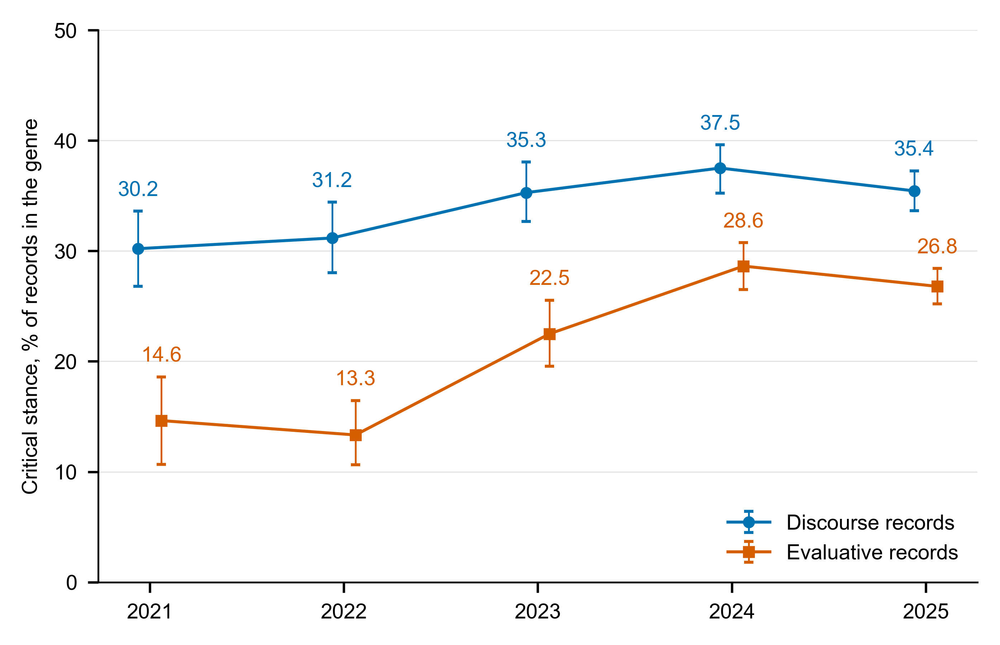
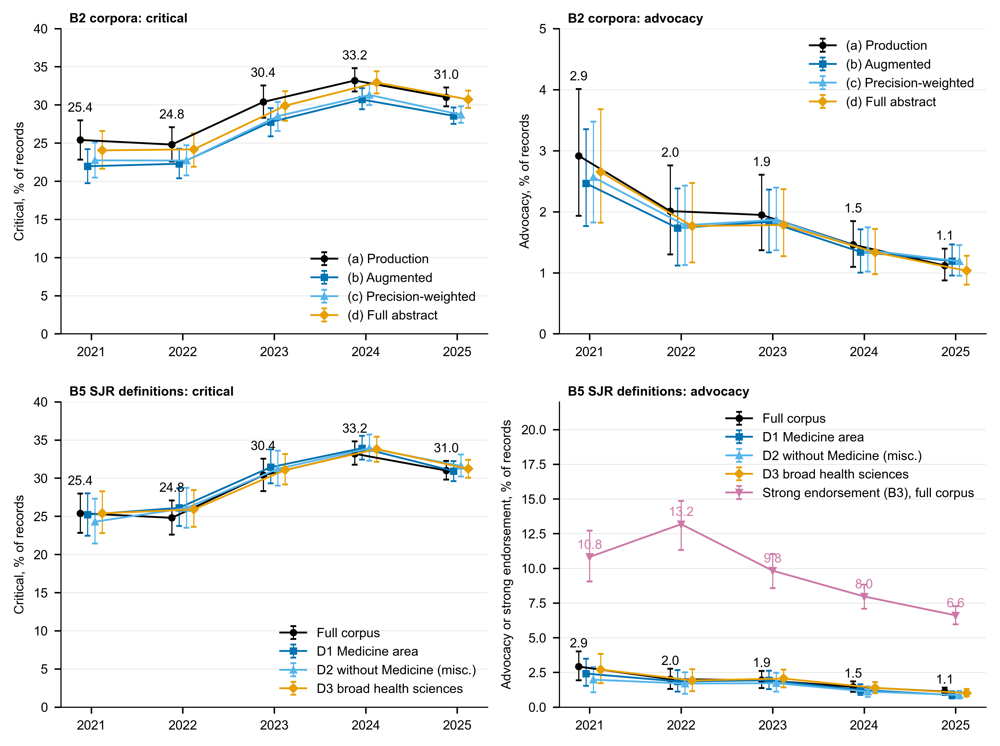
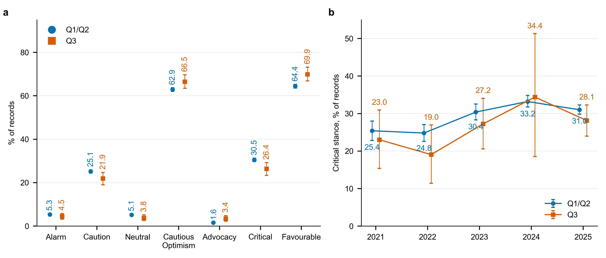
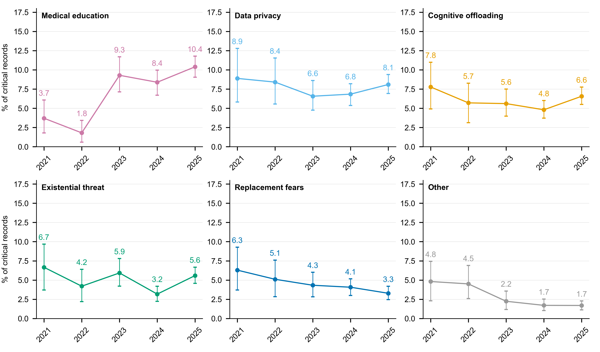
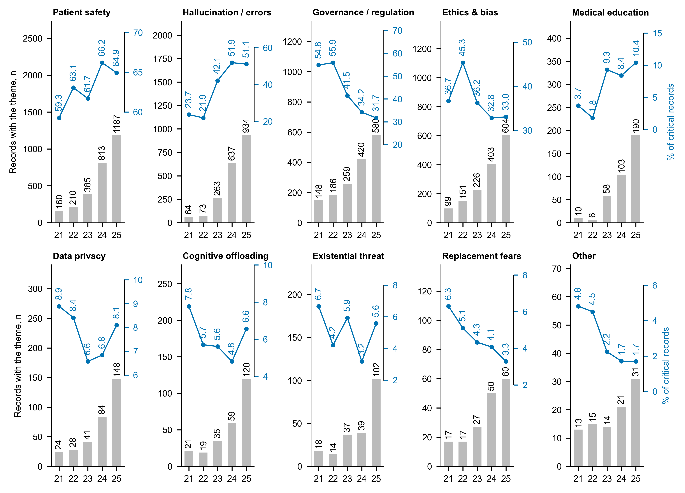
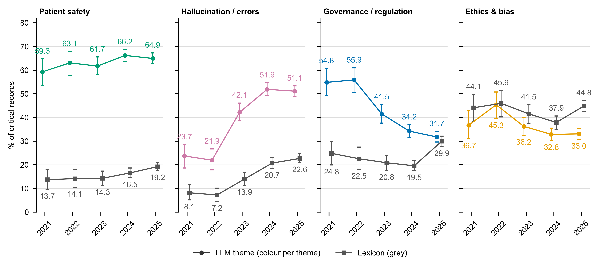
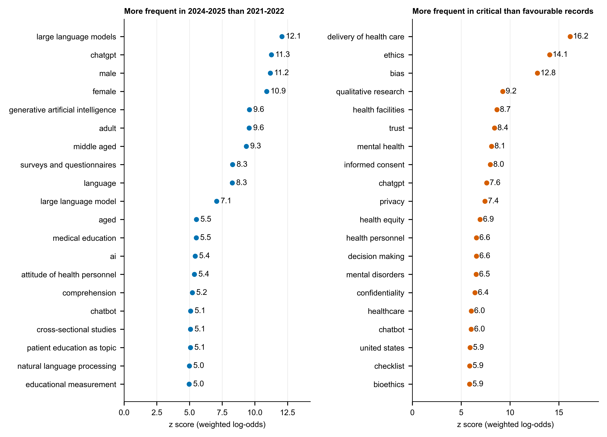
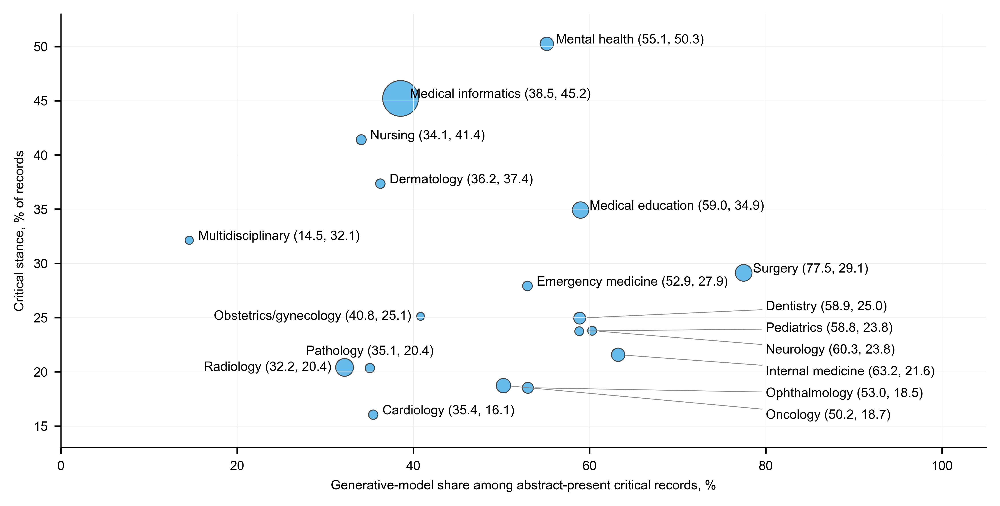
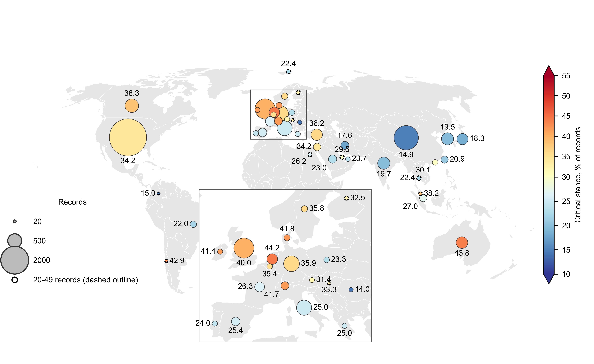
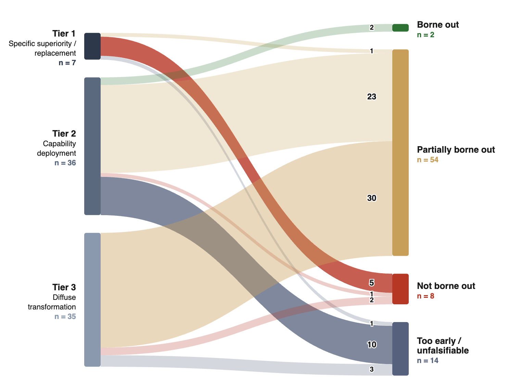

# Multimedia Appendix 2. Supplementary Figures

**Figure S1. Annual critical share within each prefilter genre, 2021-2025.** Points show the critical share within discourse and within evaluative records; whiskers show 95% percentile bootstrap CIs (1000 resamples, deterministic seed 42 + cell index); printed values are the point estimates (%). Discourse: ρ=+0.90 (*P*=.083), OR 1.061 per year (95% CI 1.015-1.108), *P*=.008; evaluative: ρ=+0.80 (*P*=.133), OR 1.209 per year (95% CI 1.144-1.277), *P*<.001 (Spearman ρ with exact P; record-level logistic OR per year). Annual n's and the discourse:evaluative ratio are in Multimedia Appendix 3, Table S11. Critical stance was Alarm or Caution. Version 2 (Batch 2d): every OR per year here comes from record-level logistic regression on publication year with journal cluster-robust SEs (95% CI and P from the cluster-robust covariance); point estimates are unchanged.

**Figure S2. Critical and Advocacy trends under alternative corpus definitions and a symmetric endorsement scale, 2021-2025.** Top: the four B2 corpora (production; augmented with records recovered by the full-abstract prefilter re-run; augmented with precision weights; full-abstract corpus). Bottom: the full corpus and three SJR medical-category restrictions (B5), with the B3 strong-endorsement share (all records as denominator) beside Advocacy. Points show annual estimates and whiskers 95% percentile bootstrap CIs (1000 joint resamples, seed 42); values are printed for the reference series (production corpus or full corpus, black) and for strong endorsement; every value with n/N for the other series is in Multimedia Appendix 3, Table S14, Multimedia Appendix 3, Table S15 and Multimedia Appendix 3, Table S13. Points are offset horizontally within each year for legibility. Critical stance was Alarm or Caution.

**Figure S3. Stance in the Q1/Q2 analytic corpus and the Q3 comparison arm, 2021-2025.** (a) Pooled 2021-2025 stance distribution for the Q1/Q2 corpus (n=14,058) and the Q3 arm (n=853), both classified with the identical v1 prompt. (b) Annual critical share by quartile tier. Points show estimates and whiskers 95% percentile bootstrap CIs (1000 resamples, seed 42); printed values are point estimates (%). Small Q3 annual counts give wide intervals; values and n/N are in Multimedia Appendix 3, Table S16. Critical stance was Alarm or Caution; favourable stance was Cautious Optimism or Advocacy.

**Figure S4. The six lower-prevalence concern themes among critical records, 2021-2025.** Annual prevalence among critical records (4283 in total; per-year n in Figure 2); points with 95% percentile bootstrap CIs (1000 resamples, seed 42) and printed point estimates (%). Themes were multilabel. Trend statistics: Medical education ρ=+0.80 (*P*=.133), OR 1.312 per year (95% CI 1.151-1.494), *P*<.001; Data privacy ρ=-0.60 (*P*=.350), OR 0.999 per year (95% CI 0.906-1.101), *P*=.987; Cognitive offloading ρ=-0.40 (*P*=.517), OR 1.000 per year (95% CI 0.890-1.125), *P*=.995; Existential threat ρ=-0.50 (*P*=.450), OR 0.987 per year (95% CI 0.856-1.139), *P*=.862; Replacement fears ρ=-1.00 (*P*=.017), OR 0.853 per year (95% CI 0.761-0.956), *P*=.006; Other ρ=-1.00 (*P*=.017), OR 0.743 per year (95% CI 0.639-0.863), *P*<.001. Pooled prevalences are in Multimedia Appendix 3, Table S17. Critical stance was Alarm or Caution. Version 2 (Batch 2d): every OR per year here comes from record-level logistic regression on publication year with journal cluster-robust SEs (95% CI and P from the cluster-robust covariance); point estimates are unchanged.

**Figure S5. Annual count and prevalence share of the ten concern themes, 2021-2025.** Grey bars (left axis): number of critical records assigned the theme each year (printed above each bar). Blue line (right axis): prevalence among critical records (printed, %), drawn in the upper part of each panel on its own scale. Two measures are shown per panel. Denominator per year: the critical records of that year (Figure 2). Themes were multilabel. CIs for the shares are in Multimedia Appendix 3, Table S17 and the R1 numbers book. Critical stance was Alarm or Caution. Years are shown as two digits (21 = 2021).

**Figure S6. LLM theme prevalence and lexicon mention share for the four headline themes among critical records, 2021-2025.** Coloured points: share of critical records assigned the theme by the LLM classifier; grey squares: share whose MeSH terms, author keywords, title or abstract match the theme's pre-specified lexicon (Multimedia Appendix 1, Note 10). Whiskers: 95% percentile bootstrap CIs (1000 resamples, seed 42); printed values are point estimates (%). OR per year: Patient safety: LLM OR 1.055 per year (95% CI 0.995-1.118), *P*=.071, lexicon OR 1.133 per year (95% CI 1.055-1.217), *P*<.001; Hallucination / errors: LLM OR 1.367 per year (95% CI 1.289-1.450), *P*<.001, lexicon OR 1.384 per year (95% CI 1.283-1.493), *P*<.001; Governance / regulation: LLM OR 0.765 per year (95% CI 0.719-0.814), *P*<.001, lexicon OR 1.128 per year (95% CI 1.050-1.212), *P*<.001; Ethics & bias: LLM OR 0.915 per year (95% CI 0.861-0.972), *P*=.004, lexicon OR 1.008 per year (95% CI 0.955-1.064), *P*=.767. Values are in Multimedia Appendix 3, Table S18. Critical stance was Alarm or Caution. Version 2 (Batch 2d): every OR per year here comes from record-level logistic regression on publication year with journal cluster-robust SEs (95% CI and P from the cluster-robust covariance); point estimates are unchanged.

**Figure S7. MeSH and keyword terms most over-represented by period and by stance, 2021-2025.** Left: terms more frequent in 2024-2025 than in 2021-2022 records; right: terms more frequent in critical than in favourable records. Top 20 terms per comparison by z score of the weighted log-odds ratio with an informative Dirichlet prior (Monroe et al. 2008; terms present in at least 20 records); printed values are z scores. The top 30 terms with their record counts are in Multimedia Appendix 3, Table S18. Critical stance was Alarm or Caution; favourable stance was Cautious Optimism or Advocacy.

**Figure S8. Critical rate against generative-model share across the 18 specialty and domain categories, 2021-2025.** Each point is one category; point area is proportional to the number of abstract-present critical records in the category; labels give (generative-model share, critical rate) in %. Generative-model share is the proportion of a category's abstract-present critical records classified as generative or both, so it is computed among critical records only. Labels for a crowded cluster are set to the right with leader lines. No fitted line is shown. Spearman correlation: ρ=+0.01 (two-sided *P*=.971). Correlations involving the FDA count, including the partial correlation, are in Multimedia Appendix 3, Table S19. Critical stance was Alarm or Caution.

**Figure S9. Critical rate by country of first authorship at the 20-record threshold, 2021-2025.** As Figure 5, but including all 42 countries with at least 20 first-author records; the 10 countries with 20 to 49 records have a dashed outline and are low-confidence estimates. Bubble area is proportional to the number of records; fill colour and the printed value give the critical rate (%). Europe is enlarged in the inset, where its values are printed; some low-count countries overlap at map scale and their values are in Multimedia Appendix 3, Table S20. Country indexes publication discourse, not national attitudes, research quality or AI capability. Critical stance was Alarm or Caution. Robinson projection.

**Figure S10. Exploratory forward-validation of early Advocacy predictions (unchanged; exploratory and Advocacy-only).** The flow diagram shows 74 papers, 78 claims from Advocacy records published in 2021-2023, grouped by falsifiability tier and adjudicated against evidence published from 2024 to April 2026. Node height and ribbon width represent claim counts. A single rater assigned each claim as borne out, partially borne out, not borne out, or too early/unfalsifiable; 'not borne out' required positive contrary evidence and corpus silence was classified as too early/unfalsifiable. The figure is reproduced unchanged from the submission (its evidence window extends to April 2026 by design). The Tier x verdict matrix is in Multimedia Appendix 3, Table S28. The analysis was exploratory, Advocacy-only, single-rater and retrieval-dependent; it does not adjudicate AI capability or whether critical stances were correct. Critical stance was Alarm or Caution; favourable stance was Cautious Optimism or Advocacy; this figure concerns Advocacy records only.

